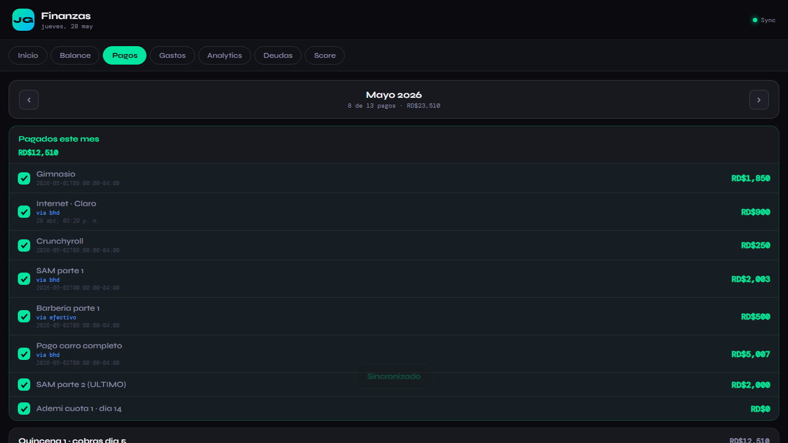

# Finanzas Javier

PWA de finanzas personales que **registra gastos automáticamente leyendo las notificaciones del banco por correo**, en vez de depender de que uno los anote a mano.

**Live:** [finanzas-javier.vercel.app](https://finanzas-javier.vercel.app)



---

## El problema

Las apps de finanzas personales fallan por la misma razón: exigen disciplina diaria. Si no registras el gasto en el momento, a la semana el dato ya no existe.

Este proyecto le da la vuelta: el banco ya envía un correo por cada transacción, así que **la fuente de verdad es el buzón**. Un cron lee esos correos cada hora, parsea el monto y el comercio, auto-categoriza el gasto y lo inserta en la base de datos. El registro manual queda como excepción, no como regla.

---

## Lo técnicamente interesante

- **Ingesta desde Gmail con OAuth2** — lectura de threads vía Google APIs, parseo del HTML de la notificación y extracción de monto, comercio y cuenta con expresiones regulares tolerantes a cambios de formato.
- **Auto-categorización** — clasificación del gasto por comercio sin intervención del usuario.
- **Ledger append-only de saldos** — `saldos` nunca se actualiza, solo se inserta; el saldo vigente sale de una vista (`saldos_actuales`). Así el histórico es auditable y no se pierde al corregir un dato.
- **Crons en Vercel** — ingesta horaria, resumen diario y reporte semanal por correo.
- **Capa de IA** — análisis del mes y chat sobre los datos propios, vía OpenRouter.
- **Migrada desde Google Apps Script** sin perder el histórico acumulado.

---

## Stack

| Capa | Tecnología |
|---|---|
| Frontend | PWA en JS vanilla (`public/index.html`) |
| Backend | Next.js 15 (App Router, API Routes) |
| Base de datos | Supabase (PostgreSQL) |
| Deploy y crons | Vercel |
| IA | OpenRouter |
| Correo | Google APIs (OAuth2) para lectura · Resend para envío |

---

## Funcionalidades

- **Inicio** — resumen del mes: saldos, ingresos, gastos y margen disponible
- **Pagos** — plan de compromisos fijos con control por quincena (Q1/Q2)
- **Registro** — alta manual de gastos e ingresos para lo que no llega por correo
- **Analytics** — gráficas de gasto por categoría y por mes
- **Deudas** — seguimiento de préstamos y cuotas
- **IA** — análisis automático del mes y chat libre sobre los datos
- **Lista** — wishlist con prioridades y precios

---

## Arquitectura

```
src/
  app/api/
    cron/
      emails/     → lee notificaciones del banco desde Gmail → inserta gastos
      diario/     → resumen diario por correo
      semanal/    → reporte semanal
    ia/           → endpoint de análisis y chat (OpenRouter)
    webhook/      → webhook de Resend
  lib/
    supabase.ts     → cliente Supabase
    gmail.ts        → OAuth2 + lectura de threads
    mailer.ts       → envío de correo
    categorizar.ts  → auto-categorización de gastos

public/index.html   → PWA completa (vanilla JS)
supabase/           → schema, migraciones y políticas RLS
scripts/            → utilidades locales (ejecutar crons, verificar estado)
```

---

## Modelo de datos

| Tabla | Descripción |
|---|---|
| `gastos` | Transacciones con categoría, cuenta y timestamp |
| `entradas` | Ingresos del mes |
| `pagos` | Compromisos fijos por quincena |
| `saldos` | Ledger append-only por cuenta |
| `saldos_actuales` | Vista: saldo más reciente por cuenta |

---

## Crons (Vercel)

| Endpoint | Frecuencia | Función |
|---|---|---|
| `/api/cron/emails` | cada hora | Parsea notificaciones del banco → inserta gastos |
| `/api/cron/diario` | 9:00 diario | Correo de resumen del día |
| `/api/cron/semanal` | lunes 8:00 | Reporte semanal |

---

## Setup local

```bash
npm install
```

Crea un `.env.local` a partir de estas variables (ninguna está versionada):

```env
NEXT_PUBLIC_SUPABASE_URL=
NEXT_PUBLIC_SUPABASE_ANON_KEY=
SUPABASE_SERVICE_ROLE_KEY=
OPENROUTER_API_KEY=
GOOGLE_CLIENT_ID=
GOOGLE_CLIENT_SECRET=
GOOGLE_REFRESH_TOKEN=
RESEND_API_KEY=
CRON_SECRET=
```

```bash
npm run dev
```

---

## Notas

Proyecto personal de uso diario. El acceso a los datos está restringido con Row Level Security en Supabase; la clave `anon` que usa el cliente es pública por diseño y no da acceso sin pasar por esas políticas.
